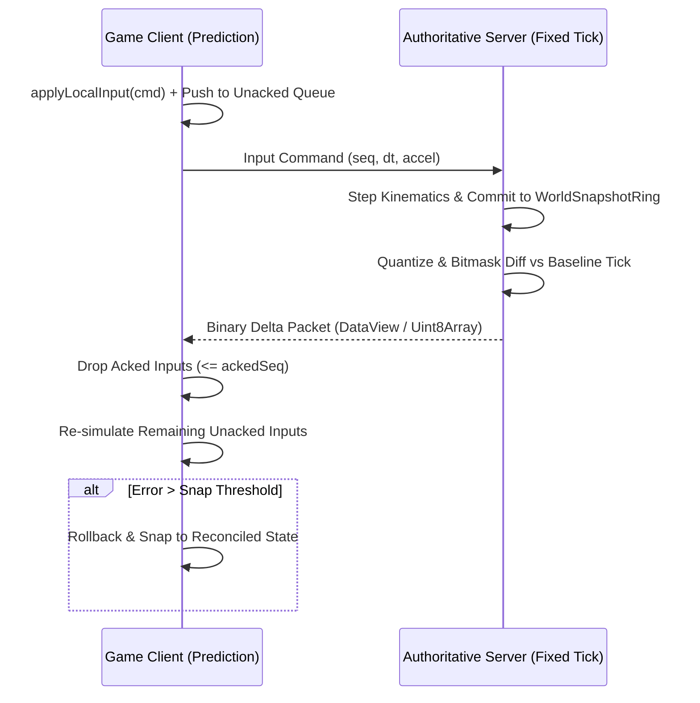

# Binary Delta-Sync Engine & Rollback Reconciliation (TypeScript)

Сетевой движок синхронизации игровых сущностей с фиксированным тикрейтом, бинарным дельта-сжатием (`DataView` + квантование с фиксированной точкой), кольцевым буфером истории снапшотов и клиентским предсказанием с откатом (Client-Side Prediction & Server Reconciliation).

## Архитектура сетевого цикла



## Инженерные решения

1. **Бинарный протокол и Delta Compression (`src/protocol/delta-codec.ts`):**
   * Упаковка пакетов напрямую в предварительно выделенный `ArrayBuffer` через `DataView` без промежуточных аллокаций.
   * Каждая сущность кодируется с 8-битной маской изменений (`DeltaField`): в пакет попадают только те поля (`PosX/Y/Z`, `VelX/Y/Z`, `Heading`, `StateFlags`), значения которых изменились после квантования относительно предыдущего тика. Статичные объекты пропускаются полностью (0 байт).
2. **Квантование с фиксированной точкой (`src/protocol/quantization.ts`):**
   * Координаты сжимаются до сантиметровой точности (`Int32`, масштаб `100`), векторы скорости — в `Int16` (`±32767`, масштаб `500`), угол поворота (`0..360°`) — в `Uint16` с точностью `~0.0055°`.
3. **Кольцевой буфер истории и интерполяция (`src/server/world-snapshot-ring.ts`):**
   * Циклический буфер снапшотов фиксированной емкости (`tick % capacity`) хранит историю мира для ретроспективных проверок (lag compensation) и линейной интерполяции удаленных сущностей между тиками (`sampleInterpolated`).
4. **Client-Side Prediction & Rollback (`src/client/prediction-reconciler.ts`):**
   * Клиент применяет ввод игрока мгновенно без ожидания ответа сервера и хранит буфер неподтвержденных команд. При получении авторитетного снапшота подтвержденные команды отбрасываются, а оставшиеся перепроигрываются поверх серверного состояния.

## Результаты бенчмарков

Замер выполнен на симуляции `250` сущностей в течение `1 000` тиков (`20 Hz` / `dt = 0.05s`) с профилированием памяти (`--expose-gc`):

| Метрика | Значение |
| :--- | :--- |
| **Трафик (JSON vs Binary Delta)** | `23.12 MB` → `0.58 MB` |
| **Экономия полосы пропускания** | **`97.5%`** |
| **Среднее время кодирования тика** | `0.132 ms` |
| **Дельта кучи за 1000 тиков (Heap Delta)** | `+27.16 KB` |
| **Rollback Audit (рассинхрон на 10-м тике)** | Откат при ошибке `0.1726 m`, перепроиграно `5` команд |

## Запуск проверки типов и бенчмарков

```bash
npm install
npm run typecheck
npm run bench
```
